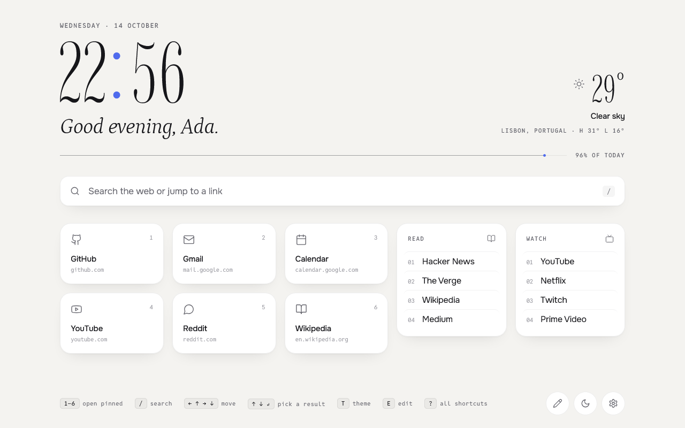
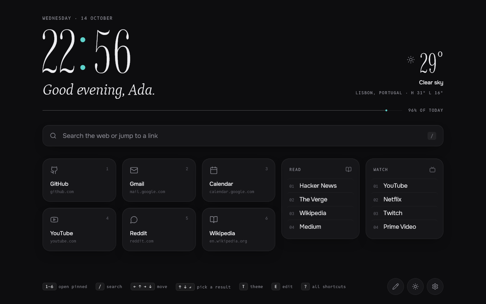
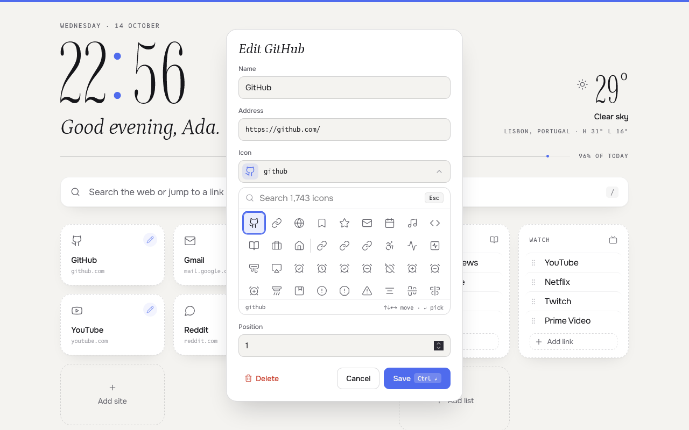
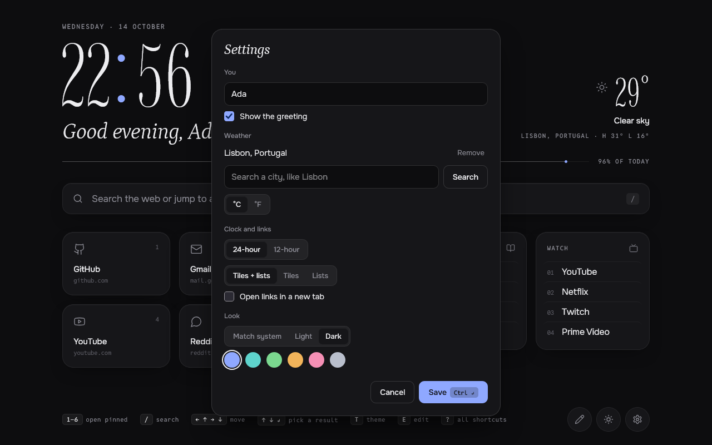

<p align="center">
  
</p>

<h1 align="center">Tiffin</h1>

<p align="center">
  <em>Bento, one tier up.</em><br />
  A fast, keyboard-first new tab and home page for Firefox.
</p>

<p align="center">
  <strong>Coming soon to addons.mozilla.org.</strong> Until then, <a href="#run-it-locally">run it locally</a>.
</p>

<p align="center">
  
  
</p>

## From Bento to Tiffin

Tiffin began as a fork of [Bento](https://github.com/migueravila/Bento), the minimalist start page by [Miguel Ávila](https://github.com/migueravila). Bento's idea is a good one: your most-used sites in tidy tiles and lists, arranged like the compartments of a bento box, all set up from one readable config file. Tiffin keeps that idea and the layouts that come with it, and owes its starting point to Miguel and Bento's contributors.

A tiffin is a stacked lunchbox, a bento with tiers. Tiffin adds a tier: it turns Bento into a Firefox extension that people who never open a config file can install, personalise and use with the keyboard alone.

**What Tiffin keeps from Bento:** the bento, lists and tiles layouts; pinned tiles and titled lists; Lucide icons; light and dark themes; a 12/24-hour clock and greetings; `config.js` for anyone who wants it; the GPL-3.0 licence.

**What changed:**

| | Bento | Tiffin |
| --- | --- | --- |
| Installing | Host it yourself (GitHub Pages or Docker), then point a new-tab add-on at it | A Firefox extension that replaces the new tab and home page |
| Editing links | Edit `config.js` | On the page: press `E`, click anything, drag to reorder, undo with `Ctrl+Z` |
| Icons | Type a Lucide icon name | Searchable icon picker with suggestions |
| Settings | Edit `config.js` | Settings panel (`,`) for name, weather, clock, layout, theme and accent |
| Across devices | Copy the config yourself | Links and settings sync with Firefox Sync, with export and import |
| Weather | OpenWeatherMap API key, plus latitude and longitude typed in | Search a city; no key; Firefox asks before the city is shared |
| Keyboard | No shortcuts | `/` search, `1`–`9` pinned sites, arrows across everything, `?` for every shortcut |
| Search | None | Searches the web or jumps straight to one of your links |
| Type and motion | Open Sans, loaded from Google Fonts | Four bundled typefaces (nothing loads from the network), a clock whose weight follows the day, quick motion that respects reduced-motion settings |
| Screen sizes | Adapts to the window's width | Adapts to width and height, so it fits one screen without scrolling |
| Privacy | Self-hosted; weather calls OpenWeatherMap with your key | No account, no analytics; [privacy policy](PRIVACY.md) |

## Features

- **Edit in place.** Press `E` or the pencil to edit, add, delete and drag tiles, lists and links. Deleting shows Undo.
- **Settings on the page.** Press `,` or the gear for your name, weather city and units, clock, layout, theme and accent colour.
- **Keyboard first.** `/` searches, `1`–`9` open pinned sites, arrow keys move across tiles, lists, search and footer, `T` switches theme, `?` lists every shortcut.
- **Search that jumps.** Type a link's name to open it, an address to go there, or anything else to search with Firefox's default engine.
- **Optional weather** from [Open-Meteo](https://open-meteo.com) for a city you choose, cached so new tabs show it instantly.
- **Type-led design.** Imbue for the clock, Petrona Italic for the greeting, Onest for the interface, Reddit Mono for labels, all bundled so nothing loads from the network.
- **Day weight.** The clock is thinnest at 1 am and heaviest at 1 pm.
- **Light and dark** follow your system, with six accent colours. No flash of the wrong theme.

<p align="center">
  
  
</p>

## Install

### Firefox

Tiffin is coming to addons.mozilla.org. Until it's listed, load it from this repo:

1. Clone it: `git clone https://github.com/RohanGupta15/tiffin`
2. In Firefox, open `about:debugging#/runtime/this-firefox`.
3. Click **Load Temporary Add-on…** and pick `manifest.json`.

A temporary add-on is removed when Firefox restarts.

### Other browsers

Tiffin also runs as a plain web page. Put the folder on any static host, then point a new-tab add-on at it:

- Firefox: [Custom New Tab Page](https://addons.mozilla.org/firefox/addon/custom-new-tab-page/); turn on "Force links to open in the top frame".
- Chromium (Brave, Vivaldi, Chrome): [Custom New Tab URL](https://chrome.google.com/webstore/detail/custom-new-tab-url/mmjbdbjnoablegbkcklggeknkfcjkjia)

As a web page, links and settings are saved in that browser only, and searches use the `searchUrl` in `config.js`.

## Run it locally

```bash
npm install
npm start        # a fresh Firefox profile with Tiffin loaded; reloads when files change
npm test         # unit tests
npm run lint     # validate the extension
npm run build    # zip into web-ext-artifacts/
```

Firefox can keep an old copy of `app.css` after reloading a temporary add-on. If a style change doesn't show, restart Firefox.

## Make it yours

Most people never need a file: edit links on the page with `E`, change everything else in settings with `,`, and press `?` for shortcuts.

`config.js` sets the defaults a new install starts with. Once someone edits a link or saves a setting, their choice wins.

| Option | What it does |
| --- | --- |
| `name` | Shown in the greeting. `''` asks for it on the first new tab. |
| `showGreeting` | `false` hides the greeting line. |
| `greetingMorning` / `Afternoon` / `Evening` / `Night` | Greeting text by time of day. |
| `twelveHourFormat` | `true` for a 12-hour clock with am/pm. |
| `dayWeight` / `dayWeightRange` | Clock weight follows the time of day, between `[lightest, heaviest]` (100–900). `false` keeps it fixed. |
| `openInNewTab` | Open links and searches in a new tab. |
| `imageBackground` | Use `assets/background.jpg` as a wallpaper with frosted tiles. |
| `bentoLayout` | `'bento'` (tiles and lists), `'lists'` (lists only), `'buttons'` (tiles only). |
| `theme` | `'auto'` follows the system; `'dark'` or `'light'` forces one. |
| `accent` | `'indigo'`, `'teal'`, `'green'`, `'amber'`, `'rose'` or `'graphite'`. |
| `searchUrl` | Search URL (`%s` is the query) when Tiffin runs as a web page. |
| `weatherUnit` | `'C'` or `'F'`. |
| `city` / `latitude` / `longitude` | Weather location. Weather stays hidden while these are empty. |

**Starter links.** `firstButtonsContainer` holds the pinned tiles and `firstlistsContainer` the lists; the `second…` versions add more for the tiles-only and lists-only layouts. Icons are [Lucide](https://lucide.dev) names from v0.469, and the first nine tiles get the `1`–`9` shortcuts.

```js
firstButtonsContainer: [
	{ name: 'GitHub', icon: 'github', link: 'https://github.com/' },
],
firstlistsContainer: [
	{
		title: 'Read',
		icon: 'book-open',
		links: [{ name: 'Hacker News', link: 'https://news.ycombinator.com/' }],
	},
],
```

**Colours and type.** Colours are CSS variables at the top of `app.css`: the light theme on `:root`, dark on `:root[data-theme='dark']`. Fonts live in `assets/fonts/`.

## Privacy

Tiffin has no account, analytics or tracking. Links and settings stay in Firefox and sync only through your own Firefox account. Weather is off until you choose a city, and Firefox asks before the city is sent to Open-Meteo. Details in [PRIVACY.md](PRIVACY.md).

## Credits

- **[Bento](https://github.com/migueravila/Bento)** by [Miguel Ávila](https://github.com/migueravila) and [its contributors](https://github.com/migueravila/Bento/graphs/contributors): the layout, the idea and the code Tiffin grew from. If you like Tiffin, give Bento a star.
- **Fonts**, all under the SIL Open Font License: [Imbue](https://fonts.google.com/specimen/Imbue), [Petrona](https://fonts.google.com/specimen/Petrona), [Onest](https://fonts.google.com/specimen/Onest), [Reddit Mono](https://fonts.google.com/specimen/Reddit+Mono).
- **Icons:** [Lucide](https://lucide.dev), ISC licence.
- **Weather:** [Open-Meteo](https://open-meteo.com).

## Licence

[GPL-3.0](License), the same as Bento.
